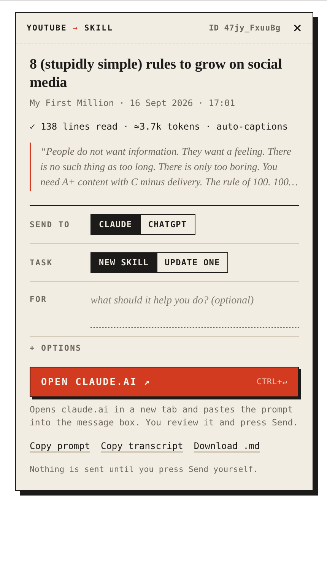
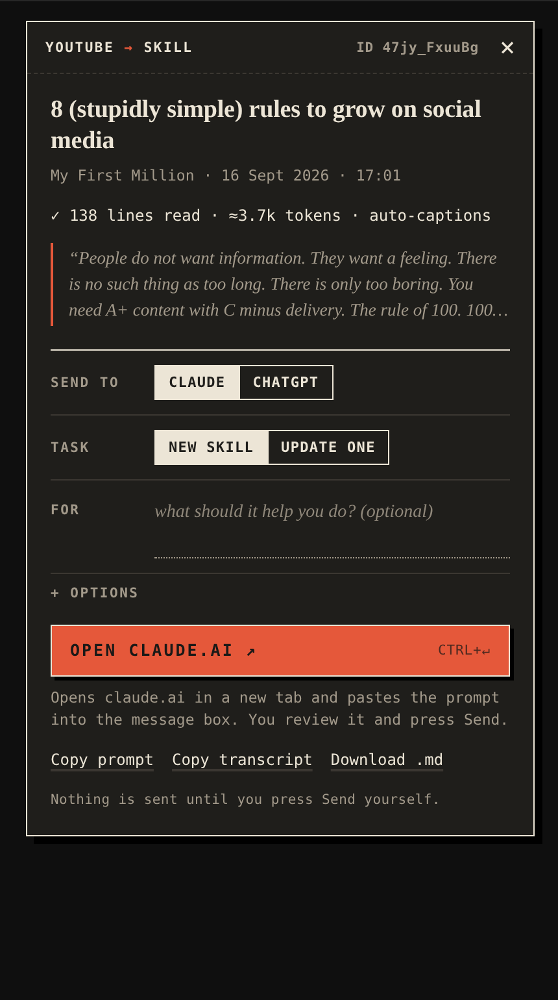
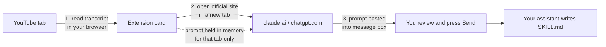

# YouTube → Skill

**Turn any YouTube video into an Agent Skill, using the Claude or ChatGPT you already pay for.**

Hover over a video, click the red ribbon, and the extension reads the transcript, opens Claude or ChatGPT in a new tab and pastes a ready-made prompt into the message box. Press Send, and your assistant writes a `SKILL.md` file that it, or any other AI agent, can follow later. It can also merge a video into a skill you already have.

Free and open source. No server, no account, no API key, no tracking.

<p align="center">
  
  &nbsp;&nbsp;
  
</p>

---

## Contents

- [What it does](#what-it-does)
- [Install](#install)
- [Use it](#use-it)
- [Install the skill (recommended)](#install-the-skill-recommended)
- [How it works](#how-it-works)
- [Troubleshooting](#troubleshooting)
- [Privacy and trust](#privacy-and-trust)
- [Develop](#develop)

## What it does

You watch a talk on sales, a tutorial on a tool, or a podcast full of advice. You want your AI assistant to *follow* that advice next time, not just summarise it once. That is what a **skill** is: a `SKILL.md` file of instructions an agent loads when the topic comes up. It is an open format, supported by Claude, Claude Code, ChatGPT, Codex, Cursor, Gemini CLI, GitHub Copilot and others.

This project has two parts that work together or separately:

| Part | What it is |
|---|---|
| **Chrome extension** (`extension/`) | Adds a ribbon to YouTube, reads the transcript in your browser, and hands it to Claude or ChatGPT with the right prompt. |
| **youtube-to-skill skill** (`skills/youtube-to-skill/`) | Teaches your assistant how to turn a transcript into a good skill: what to extract, how to structure it, how to merge it into an existing skill without overwriting your own material, and which claims to flag. Works on its own with a pasted transcript, no extension needed. |

## Install

Works in Chrome, Edge, Brave, Arc and other Chromium browsers. It isn't on the Chrome Web Store yet, so it is installed in developer mode, which takes about a minute.

1. **Download** `yt2skill-extension.zip` from the [latest release](../../releases/latest).
2. **Unzip it.** You get a folder containing `manifest.json`.
3. Open **`chrome://extensions`** in your browser.
4. Turn on **Developer mode** (switch in the top-right corner).
5. Click **Load unpacked** and select the unzipped folder, the one that contains `manifest.json`.
6. Optional: click the puzzle-piece icon in the toolbar and **pin** YouTube → Skill.
7. **Refresh** any YouTube tabs you already had open.

Keep the folder where it is: Chrome loads the extension from it. To update later, replace the folder's contents with the new release and click the reload icon on the extension's card in `chrome://extensions`.

<details>
<summary>Prefer to install from source?</summary>

```sh
git clone https://github.com/hhalilcelikk/yt2skill.git
```

Then follow steps 3–7 above, selecting the `extension` folder inside the clone.
</details>

## Use it


1. On YouTube, **hover** over a thumbnail or the video player. A red ribbon appears in the corner: click it. On a video page you can also click the toolbar icon or press **Alt+Shift+S**.
2. A card slides in from the right and reads the transcript. Check the title and the opening line to make sure it is the right video.
3. Choose:
   - **Send to**: Claude or ChatGPT.
   - **Task**: *New skill*, or *Update one* and type the name of an existing skill (for example `sales-playbook`).
   - **For** (optional): what you want the skill to help with, e.g. "follow this whenever I plan LinkedIn content".
4. Click **Open claude.ai** (or chatgpt.com), or press **⌘/Ctrl+Enter**.
5. A new tab opens with the prompt pasted into the message box. **Review it and press Send.**

The card also has **Copy prompt** (for any other assistant), **Copy transcript** and **Download .md** (a clean transcript with metadata).

Under **Options** in the card: turn off *Include full instructions* once the skill is installed (shorter prompts), and choose whether to keep timestamps.

## Install the skill (recommended)

The extension works without it: by default each prompt carries a condensed version of the instructions. With the skill installed, results are more consistent and prompts are shorter.

Download `youtube-to-skill.zip` from the [latest release](../../releases/latest), or use the `skills/youtube-to-skill` folder from this repo.

| Where | How |
|---|---|
| **Claude** (claude.ai and the apps) | Upload `youtube-to-skill.zip` in the part of Claude's settings where you manage skills. |
| **Claude Code** | Unzip to `~/.claude/skills/youtube-to-skill/` (the folder must contain `SKILL.md`). |
| **Codex, Cursor, Gemini CLI, Copilot and other Agent Skills tools** | Copy the `youtube-to-skill` folder into that tool's skills directory. |

Then, in the extension's card, open **Options** and untick **Include full instructions**.

The skill also works without the extension: paste any transcript into your assistant and ask it to turn it into a skill.

## How it works



**1. Reading the transcript.** Everything happens in your browser, on youtube.com, with your normal session. The extension tries, in order:

1. the **transcript panel** on the page (it clicks "Show transcript" and reads it), which is the most reliable method;
2. YouTube's **transcript endpoint**, the one the panel itself uses;
3. the **caption track** listed in the player data.

YouTube currently rejects methods 2 and 3 for many videos. So when you click the ribbon on a thumbnail rather than an open video, the card may offer to **open the video**; it then reopens itself there and reads the panel. On videos with AI-dubbed audio it picks the original-language captions, not the first track listed.

**2. Building the prompt.** The transcript becomes a Markdown document with the title, channel, date, length, description and timestamped paragraphs. The prompt wraps it with your task and goal, marks the transcript as data rather than instructions, and either points to the youtube-to-skill skill or includes condensed instructions.

**3. Handing it over.** The extension opens claude.ai or chatgpt.com in a new tab and pastes the prompt into the message box, the same way a paste with ⌘V would. On ChatGPT a long prompt arrives as an attachment ("Show in text field"); on Claude it arrives as text. Both are normal. The prompt is also on your clipboard as a backup.

**Why not send it automatically, or use the desktop apps?** Anthropic's terms do not allow third-party tools to run prompts on Claude Free, Pro or Max subscriptions, and pressing Send for you would cross that line. Desktop-app links make the apps warn about content arriving from another app. A browser tab is transparent: you can see exactly what will be sent before you send it.

## Troubleshooting

| Problem | Fix |
|---|---|
| "Manifest file is missing" when loading | You selected the outer folder. Select the folder that directly contains `manifest.json`. |
| No ribbon on YouTube | Refresh the YouTube tab after installing or updating. Ribbons appear on thumbnails and the player, not on channel banners. |
| "Could not read the transcript" | Open the video, click **…more** under it, then **Show transcript**, and press **Retry** in the card. If it still fails, open an issue with the video link and the card's *Technical details*. |
| "This video has no captions" | The video has no captions or transcript, so there is nothing to read. |
| Prompt didn't appear in Claude or ChatGPT | Make sure you are signed in, then click the message box and press ⌘V / Ctrl+V; the prompt is on your clipboard. |
| Prompt is very long | Install the skill and untick *Include full instructions*, or untick *Keep timestamps*. |

## Privacy and trust

The full policy is in [PRIVACY.md](PRIVACY.md). In short:

- **Two permissions only:** `storage` (your settings) and `clipboardWrite` (the backup copy of the prompt). No host permissions beyond the sites below, no downloads, no tabs access.
- **YouTube:** it reads the transcript of the video you choose, from your browser.
- **claude.ai and chatgpt.com:** it acts only in a tab it opened itself. It pastes the prompt once and reads nothing else. On every other Claude or ChatGPT tab it does nothing.
- **Never sends anything.** No analytics, no server, and it never presses Send.
- **Small and readable.** The whole extension is a few plain JavaScript files with no build step and no dependencies, so you can read exactly what it does.

Not affiliated with YouTube, Google, Anthropic or OpenAI.

## Develop

```sh
npm test            # unit tests (Node 18+, no dependencies)
npm run sync        # copy skills/youtube-to-skill/SKILL.md into the extension
npm run package     # build dist/yt2skill-extension.zip and dist/youtube-to-skill.zip
python3 scripts/make-icons.py   # regenerate icons (needs Pillow)
```

Edit the skill in `skills/youtube-to-skill/SKILL.md`, then run `npm run sync`; a test fails if the bundled copy is out of date. The condensed instructions in `extension/content/prompt.js` should stay in line with the skill.

| File | Role |
|---|---|
| `extension/content/core.js` | Settings and helpers |
| `extension/content/transcript.js` | Transcript extraction and Markdown output |
| `extension/content/prompt.js` | Prompt text and condensed instructions |
| `extension/content/ui.js` | Ribbon and card (Shadow DOM, no `innerHTML` because YouTube enforces Trusted Types) |
| `extension/content/main.js` | Hover tracking, toolbar and shortcut handling |
| `extension/chat/fill.js` | On claude.ai / chatgpt.com: pastes the waiting prompt once, only in a tab the extension opened |
| `extension/background.js` | Opens the chat tab and hands it the prompt once |

YouTube changes its page often; transcript extraction is the part most likely to need fixes. Pull requests are welcome; please run `npm test` first.

### Roadmap

- Chrome Web Store listing
- Firefox build
- Chapter titles as headings in the transcript
- Optional bring-your-own-API-key mode

## License

MIT. See [LICENSE](LICENSE).
